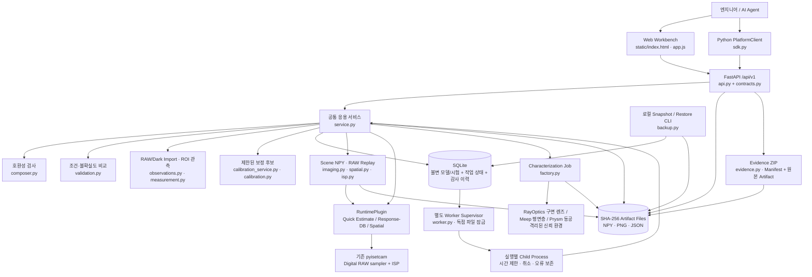
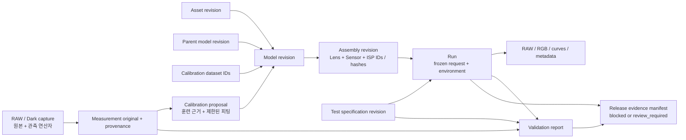

# Camera System Engineering & Validation Platform 아키텍처

이 문서는 현재 `src/camera_platform`의 실행 구조와 확장 경계를 설명합니다.
현재 플랫폼 버전은 **단일 호스트에서 실행하는 v0.5.0 엔지니어링 에디션**입니다.
플랫폼 버전은 기존 pyisetcam 배포 버전과 별도로 관리합니다.
버전이 고정된 응답 모델을 조합하고, RAW/RGB와 근거를 보존하며, 같은 시험 조건의
데이터를 비교할 수 있습니다. 명시한 형식의 RAW 취득 자료를 분석하고 제한된 보정
후보를 만들며, Registry와 원본 Blob을 새 위치로 백업·복구할 수 있습니다. 상용
운영 환경이나 실물 카메라의 검증 완료 상태를 의미하지 않습니다.

설계의 중심은 `설계/관측 → 모델 버전 → 카메라 조합 → 시험 → 실행 → 비교 근거`입니다.
정밀 해석기를 매번 직렬 실행하기보다 재사용 가능한 응답을 등록하는 흐름과,
그 응답을 이용해 카메라를 평가하는 흐름을 분리합니다.

## 현재 실행 구조



API는 입력 확인과 작업 등록을 처리합니다. 관리 Worker는 SQLite 작업을 가져와
실행별 자식 프로세스를 시작합니다. Simulation Run의 RAW/ISP 연산은 HTTP 요청과
분리됩니다. RAW Import 분석과 제한된 보정 요청은 현재 동기 서비스 경로입니다.
기본 Run 실행 제한은 작업당 120초이며, 작업 취소와 Worker
종료 시 실행 프로세스를 중단합니다. 시작할 때 중단되어 남은 `running` 작업은
실패로 기록하여 새 제출로 재시도하게 합니다.

현재는 상태 디렉터리 하나에 Worker 하나가 대응합니다. 이는 분산 스케줄러, 작업
우선순위, GPU 예약, 다중 호스트 실행, 외부 장비 제어를 구현한 구조가 아닙니다.
배포 구성은 단순하게 유지하면서 그 기능을 추가할 코드 경계를 먼저 구분했습니다.

## 일곱 모듈의 현재 범위

| 모듈 | 실제 구현 및 파일 | 아직 필요한 기능 |
| --- | --- | --- |
| Asset Registry | `contracts.py`, `registry.py`, `service.py`: 자산/모델/측정 원본의 출처·버전·해시, RAW/Dark와 분석 원본 보존, 기존 카탈로그 읽기 전용 조회 | 원본 설계 파일 관리, 대용량 축 배열 저장, 자산별 권한, 출처 인증과 배포권 검토 |
| Model Factory | `factory.py`: 영속 작업·원본·환경 고정; 실제 RayOptics 구면 렌즈 분광/각도 응답과 재사용 후보; Meep 평면층 signed flux·독립 수치 검사; Prysm 선언 동공 PSF·복소 Kernel OTF; 응답 등록과 제한 R/B 피팅 | 일반 광학/픽셀 구조·처방 파면 추출, 광학흡수→전하 수집 모델, 검증된 불확실도, 임의 파라미터 피팅 |
| Camera Composer | `composer.py`: 모델 버전 고정, image circle/센서 크기·각도·파장·RAW 형식·조건·중복 효과 검사 | 초점/조리개/기구 공차 계약, 임의 ISP Graph, 명시적 단위·좌표 변환 Adapter |
| Simulation Runtime | `runtime.py`: 센서면 분광 광량 Quick Estimate, 각도분포 기반 정적 Shading, 기존 pyisetcam RAW/ISP 연결, 고정된 ROI 연산자의 기대 관측값. `spatial.py`의 native 분광 영상·국소 PSF·RAW/ISP, `imaging.py`·`isp.py`의 원본 RAW 재처리와 중간 프레임 | 3D/깊이·가림·공간별 PSF, 폐루프 AE/AWB/HDR·기하학적 3D 움직임, 실제 HW ISP Backend, 검증된 Surrogate |
| Validation Center | `validation.py`의 조건·축·단위·효과·독립성 비교; `measurement.py`의 RGGB RAW/Dark ROI 분석과 `observations.py`의 원본 재분석 확인 | 실제 장비 제어, 벤더 RAW 디코더, 표준별 분석 Adapter, 모델 불확실도 전파 |
| Experiment & Optimization | `create_experiment()`: 카메라 조합과 노출의 제한된 Sweep, 전체 계획 사전 검사, 조건별 시험 Snapshot | 다목적 최적화, 민감도/공차 분석, 적응형 추가 측정·해석 선택 |
| Agent & Release Control | 동일 HTTP API와 `PlatformClient`, 작업·비교·감사 조회, Release 근거 및 차단 사유, `evidence.py`의 원본 ZIP, `backup.py`의 검증된 로컬 복구 | Agent 계획 정책, 역할별 권한, 독립 검토/최종 승인, 서명, 배포 및 변경 영향 자동 분석 |

화면에서 메뉴가 존재하거나 카탈로그에 도구 이름이 보이는 것과 해당 계산이 연결된
것은 다릅니다. 현재 실행 가능한 경로는 Quick Estimate·Response DB·native 공간 Runtime, 보존 RAW의 ISP 재처리, 응답 테이블 등록,
공통 RAW ROI 관측, 제한된 각도응답 보정 후보, 제한된 RayOptics·Meep·Prysm
특성화입니다. 전체 Scene/Time 시뮬레이터와 일반 센서 FDTD 설계기의 완료를 의미하지 않습니다.

분광 Lens는 Sensor와 정확히 일치하는 파장 축에서 각도 분포와 상대 조도를 적분합니다.
Factory 후보의 원본 Job 연결과 모든 적용 조건을 보존하고, 숫자 조건은 고정 범위로
제한합니다. 직접 모델 등록으로 Factory 출처를 가장하거나 적용 범위를 넓힐 수 없습니다.
Meep은 서버의 신뢰된 실행 환경에서 고정된 스크립트를 실행합니다. 취소/시간 제한은
별도 실행 프로세스 그룹 전체에 적용되며, Solver 실패의 입력과 로그를 보존합니다.

## 도메인 기록과 불변성



`AssetCreate`와 `ModelCreate`는 설계·제공 자료·실측·시뮬레이션·추정을 출처로
구분합니다. 기존 값을 덮어쓰지 않고 새 레코드와 부모 모델 ID를 등록합니다.
모델 후보가 부모의 보정 데이터 사용 이력을 지워서 독립 검증처럼 보이게 만들지
않도록 보정 데이터 계보를 이어받습니다. RAW 보정에는 Dataset ID뿐 아니라 각 프레임의
정규화된 정수 픽셀 해시도 남깁니다. 같은 픽셀의 파일 재인코딩·프레임 재정렬·일부
프레임 재사용을 새 독립 취득으로 등록하지 않으며, 비교에도 같은 내용 식별자를
적용합니다. 출처를 숨기거나 픽셀을 수정한 자료의 독립성을 인증하는 장치는 아닙니다.

`AssemblyCreate`는 Lens/Sensor/ISP 모델 ID를 고정합니다. `TestCreate`는 비교할
특성, 단위, 축 의미, 조건, 적용 범위, 허용 오차를 연결합니다. Run 제출 시 해당
모델과 시험의 Snapshot, 실제 Runtime 입력, 코드 해시, 환경, 계산량을 고정합니다.
노출 Sweep은 원래 시험을 변경하지 않고 파생 시험 Snapshot을 생성합니다.

`SQLiteRegistry`는 일반 도메인 레코드와 감사 기록의 UPDATE/DELETE를 차단합니다.
작업 상태는 별도의 가변 기록이며 `queued → running → succeeded/failed/cancelled`
상태를 가집니다. 종료 상태의 작업은 수정·삭제할 수 없으며, 결과를 읽을 때 완료
감사 이벤트의 해시와 결과 해시를 확인합니다. 동일 고정 입력의 완료/활성 작업을
캐시로 재사용할 수 있고, 같은 캐시 키에 다른 입력을 제출하면 거부합니다. 실패한
작업이나 강제 재실행은 새 작업으로 남습니다.

대용량 출력은 메타데이터에 넣지 않고 SHA-256으로 식별하는 파일로 저장합니다.
조회 시 원본 해시를 확인합니다. JSON 원문 측정 Import 경로는 제출된 UTF-8 원문을
보존하며, 구조화된 JSON API 경로는 정규화된 제출 객체를 원본으로 보존합니다.
별도 RAW Import는 명시한 선형 RGGB 정수 NPY 배열과 선택적 Dark 배열을 받습니다.
센서 크기·Pixel pitch와 Native crop/CFA 좌표를 확인하고, ROI별 채널 평균의
R/G·B/G를 계산하여 관측 연산자와 함께 새 시험 및 측정 기록으로 고정합니다.
원본 RAW와 분석 결과를 등록·보정·비교 시 다시 확인하므로 측정값이나 취득 메타데이터만
바꿔 원본 분석으로 주장할 수 없습니다. 임의 벤더 RAW 디코더나 표준 적합성 분석은
아니며, ADC 끝값 검사는 숨은 Full-well 포화를 입증하지 않습니다.

RAW/Dark 입력 합계는 64 MiB로 제한합니다. NPY v1/v2의 C-order 정수
`[frames, rows, columns]` 배열만 허용하며 객체·Pickle·ZIP·Fortran 배열은 거부합니다.
ROI는 1–32개이며 CFA 채널별 최소 16개 표본을 요구합니다. 일반 JSON 입력은 2 MiB,
RAW multipart 요청은 68 MiB로 제한합니다. 실제 장비 취득과 광원·선형성·계측 교정의
근거는 별도로 제공해야 합니다.

Run/Release의 `/export`는 근거와 해시 및 Artifact 참조를 가진 JSON Manifest입니다.
별도 `/bundle`은 `evidence.py`에서 Manifest와 해당 Run의 모든 Artifact 원본을
ZIP으로 만듭니다. Release ZIP은 연결된 Validation에서 참조한 Measurement의
등록 원문 바이트와 연결된 RAW/Dark 취득 원본도 포함합니다. 보정 후보가 사용된 경우
Validation 유무와 관계없이 부모 모델 계보·보정 보고서·훈련 시험/측정/취득 근거를
따라 포함합니다. SHA-256으로 식별되는 파일은 한 번만 포함하며, ZIP 생성 전에
원본 파일의 해시를 확인합니다.

현재 제한은 포함할 Artifact의 압축 전 바이트 합계 256 MiB입니다. HTTP 전송 후
임시 ZIP을 정리합니다. 이 ZIP은 해당 실행/비교의 근거를 오프라인에서 읽고 검증할
수 있는 Package이며, Python 환경·Container·소스 전체·Registry 전체의 백업이나
자동 복구/재실행 Package는 아닙니다. Export로 기존 검증/승인 상태가 바뀌지 않습니다.

Registry 전체 복구에는 별도 `backup.py` Snapshot을 사용합니다. SQLite의 일관된
Snapshot과 참조 Blob을 고정한 뒤 Schema·불변성 Trigger·감사 이력·작업 상태·원본 해시를
검사합니다. 복구는 존재하지 않는 새 디렉터리에만 가능하며 검사 완료 후 원자적으로
공개합니다. Archive 16 GiB, 전체 압축 해제 16 GiB, 개별 파일 4 GiB 제한이 있습니다.
현재 Schema의 데이터 복구이며 소스·Python 환경·서명·암호화·Schema Migration은
포함하지 않습니다. 복구 자체는 API나 Worker를 시작하지 않습니다.

## 물리 계약과 검증 경계

Runtime의 세부 수식·요청 예제·배열 축은 [Runtime 계약](camera-platform-runtime.md)에
정의되어 있습니다. 특히 다음 경계를 유지합니다.

- 센서면 입사광은 `W/m^2/nm`, 파장은 `nm`로 선언합니다. Lux나 RGB를 조용히
  분광 입력으로 변환하지 않습니다.
- QE는 수집 전자/입사 광자 기준입니다. CFA·Microlens·전하 수집을 이미 포함한
  QE에 같은 효과를 다시 곱하지 않습니다. Lens의 각도분포는 광량 분율입니다.
- Runtime이 생성하는 RAW는 정규화된 시야를 표본화한 대표 RGGB Raster입니다. 각 표본의 전하는
  native pixel 면적에 대응하지만 출력 전체가 실제 센서의 연속된 원해상도 ROI는
  아닙니다. PSF·해상도·MTF에 관한 근거로 사용하지 않습니다.
- Import한 실측 RAW는 선언한 Native sensor/crop 좌표로 분석합니다. 비교용 예측은
  같은 CFA/ROI 연산자로 연속 기대값을 평균합니다. ADC 양자화와 유한 프레임 잡음은
  이 기대값과 다르며, 반복 측정 표준오차가 전체 절대 불확실도 경계를 대신하지 않습니다.
- RGB는 unity WB, identity CCM, LSC 해제 조건의 센서 채널 시각화입니다.
  색도계로 보정된 sRGB 출력이 아닙니다.
- 구현 검증, 도구 간 비교, 실물 예측 검증은 별도 판정입니다. 계산 성공만으로
  실물 검증 PASS를 부여하지 않습니다.

`compare()`는 단위나 축을 자동 변환하지 않고, 같은 의미의 관측인지 먼저
검사합니다. 데이터가 맞지 않으면 `INVALID_COMPARISON`, 적용 범위를 벗어나면
`OUT_OF_DOMAIN`, 불확실도가 누락되거나 판정 경계를 가로지르면 `INCONCLUSIVE`로
남깁니다. 예측·측정의 절대 불확실도 경계는 독립성을 가정하지 않고 더해 비교합니다.

**현재 Runtime의 예측 불확실도는 항상 unknown입니다.** 따라서 실측을 업로드하여
곡선이 일치하더라도 현재 계산 경로의 실물 검증을 완료할 수 없습니다. 실물 검증을
출시 근거로 사용하려면 응답 모델의 불확실도를 산출하고 출력 특성까지 전파하는
계산 경로가 먼저 필요합니다. 데이터가 없는데 0으로 채워 이 경계를 통과시키지
않습니다.

보정은 Green, 정상 입사 QE와 응답 정규화, Lens, 광원, Readout을 고정하고
비영 입사각 노드의 R/B 응답 배율만 제한된 선형 최소제곱으로 추정합니다. Rank·조건수·
QE 상한을 확인하고 식별할 수 없는 피팅은 거부합니다. 통합 경로는 등록된 RAW와
일치하는 Dark 취득을 요구하며, 실측은 Native geometry·동일 Serial·동일 온도와 외부
선형성 근거가 필요합니다. Synthetic 데이터는 구현 검증용으로 구분합니다.
새 후보 모델과 훈련 계보를 보존하되 승인하거나 훈련 잔차를 예측 불확실도로 사용하지
않습니다. 세부 입력과 제한은 [Calibration 계약](camera-platform-calibration.md)에 있습니다.

## API와 Agent 접근

`api.py`는 `/api/v1`과 OpenAPI를 제공하고, UI와 `sdk.PlatformClient`가 같은
서비스를 사용합니다. 대표 작업은 다음과 같습니다.

| 작업 | 현재 HTTP 경로 |
| --- | --- |
| 모델 등록 / 조합 검사 | `POST /api/v1/models`, `POST /api/v1/assemblies/check` |
| 계산 / 상태 / 취소 | `POST /api/v1/runs`, `GET /api/v1/runs/{id}`, `POST /api/v1/runs/{id}/cancel` |
| Sweep | `POST /api/v1/experiments` |
| 실측 등록 / 원문 Import | `POST /api/v1/measurements`, `POST /api/v1/measurements/import` |
| RAW/Dark 취득 Import | `POST /api/v1/captures/import` (`metadata`, `raw`, 선택적 `dark` multipart) |
| 제한된 보정 후보 생성 | `POST /api/v1/calibrations` |
| 비교 / Release 준비 | `POST /api/v1/validations`, `POST /api/v1/releases` |
| JSON 근거 / 감사 조회 | Run·Release `/export`, `GET /api/v1/artifacts/{hash}`, `GET /api/v1/audit` |
| 원본 포함 Evidence ZIP | `GET /api/v1/runs/{id}/bundle`, `GET /api/v1/releases/{id}/bundle` |

서버는 Loopback에 바인딩하고 Host/Origin 및 변경 요청의 로컬 Token을 확인합니다.
이 Token은 로컬 웹 접근 경계이며 사용자 인증이나 프로젝트별 권한이 아닙니다.
SDK에는 별도의 관리자 권한이 없습니다. 동일 API를 사용한다고 해서 최종 승인이나
측정 원본의 진위를 자동 판단하는 Agent 기능이 구현된 것은 아닙니다.

전체 상태의 백업·복구는 HTTP와 분리된 로컬 CLI입니다.

```sh
python -m camera_platform backup --state-dir STATE --output NEW.zip
python -m camera_platform restore --archive NEW.zip --state-dir NEW_STATE
```

Archive와 복구 경로는 새 경로여야 하며 부모 디렉터리는 존재해야 합니다. 복구된 `queued/running`
기록은 그대로 보존됩니다. Worker를 나중에 시작하면 일반 복구 정책에 따라 남은
`running` 작업을 실패로 기록하므로 먼저 상태를 검토해야 합니다.

## Plugin을 확장하는 절차

`RuntimePlugin`은 `describe_capabilities()`, `validate_request()`,
`estimate_resources()`, `execute()`를 정의합니다. 실행 결과는 JSON Summary와
NumPy Artifact 배열을 분리합니다. 현재 Plugin 등록은 `RUNTIMES` 사전이며,
별도 배포 Package의 자동 발견/격리 기능은 없습니다.

새 Adapter를 추가할 때는 다음 순서를 따릅니다.

1. 역할, 지원 물리 효과, 기준면, 배열 축/단위, 적용 범위, 입력 원본의 출처를
   계약으로 고정합니다. 미지원 효과와 명시적 근사를 Capability에 기록합니다.
2. 형식 검증과 물리 검증을 먼저 구현하고 범위 밖 입력을 거부합니다. 필요한 단위
   변환/스펙트럼 추정은 별도 이름과 버전, 부모 근거가 있는 변환으로 만듭니다.
3. Runtime 또는 Characterization 구현을 별도 모듈에 둡니다. 외부 Solver의
   실패를 다른 계산으로 숨기지 않고, 수치 설정·실행 버전·경고를 반환합니다.
4. `RUNTIMES`, 공개 Run 계약의 Plugin 허용 목록, `service.py`의 모델→요청
   변환 및 효과 계약을 함께 확장합니다. 현재 두 Adapter에 맞춘 RAW/ISP 제한을
   변경할 때는 형식 소비자까지 검사합니다.
5. 알려진 해석해, 에너지/단위 불변식, 반복 재현성, 실패 경계, 실제 출력 배열을
   확인합니다. Solver 수렴성·교차도구 비교·독립 실측 검증을 각각 기록합니다.
6. 증거 배열/원본/환경을 기존 Registry 경로로 보존하고 API·SDK·Worker 경로까지
   연결합니다. Test 통과를 모델 승인이나 배포권 확보로 대신하지 않습니다.

기존 `pyisetcam` 계산 코드를 플랫폼 도메인 객체에 종속시키지 않습니다. 필요한
입출력 변환은 Adapter에서 맡고, 기존 엔진은 별도 도구와 연구에도 재사용합니다.

## 운영 확장을 위한 다음 경계

현재 `Registry` Protocol은 일반 레코드의 `put/get/list`만 선언하고,
`PlatformService`는 `SQLiteRegistry`를 직접 생성합니다. 저장 Backend를
완전히 교체할 수 있는 의존성 주입 구조는 후속 작업입니다.

| 추가할 경계 | 책임 | 교체 이후에도 유지할 계약 |
| --- | --- | --- |
| Metadata repository | PostgreSQL 트랜잭션, 불변 버전, 질의·인덱스 | 같은 ID/출처/해시/부모 관계, 명시적 Schema Migration |
| Job repository | 원자적 claim, lease/heartbeat, 재시도, 취소 | 고정 입력, 실행 시도 구분, 중복 완료 방지 |
| Artifact store | Object Store 업로드·조회·수명주기 | 바이트 해시, 원본 보존, 레코드와 참조의 일관성 |
| Array dataset adapter | Xarray/Zarr 등의 축·Chunk 표현 | 차원 이름, 좌표, 단위, 기준면, 변환 계보 |
| Authorization policy | 사용자·프로젝트·자산·장비별 접근 | API/SDK/Worker/Artifact Export 모두 같은 정책 |
| Approval service | 검토자와 작성자 분리, 승인 기록·철회 | 측정 원본, 기준값, Calibration/Validation 데이터 분리 |

모든 기능을 Microservice로 분할할 필요는 없습니다. 같은 코드베이스에서 인터페이스와
트랜잭션 경계를 먼저 고정하고, 계산량 또는 운영 요구가 확인된 부분을 분리합니다.

## 출처·라이선스·무결성의 의미

원본·모델·실행에는 `source_kind`, `source_uri`, `license`,
`method_and_version`, 적용 범위와 부모 이력을 보존합니다. 이 정보는 사용자가
제공한 출처 주장도 포함하므로 계약서·벤더 허가·교정 성적서 자체의 진위 검증을
대신하지 않습니다.

SHA-256은 보존한 바이트가 바뀌었는지 확인합니다. 로컬 감사 Hash Chain은 변경
흔적을 제공하지만 외부 서명이나 신뢰 기관의 Timestamp가 아닙니다. 서버를 관리하는
사람에 대한 변조 방지 보증이나 법적 적합성 인증도 아닙니다.

라이선스가 unknown인 일부 기록은 Release 준비에서 차단하지만, 허용 문자열이
있다는 이유만으로 재배포권이 확보되었다고 판단하지 않습니다. 상용화 전 엔진,
의존성, 원본 설계/특성 데이터와 생성 결과의 배포 조건을 별도로 검토해야 합니다.
[상용화 완료 기준](camera-platform-commercialization.md)은 현재 구현과 후속
출시 조건을 나누어 설명합니다.

## v0.4 공간·재처리 경계

`SpectralImageImport`는 불변 NPY 원본·메타데이터·Scene 자산을 연결합니다. `RunCreate.scene_id`와 Test의 Scene ID·내용 해시가 일치해야 합니다. Worker는 등록 시 고정한 소스/환경과 원본 Blob 해시를 다시 검사합니다. Sensor 파장·픽셀 간격·전체 크기와 Scene/PSF가 다르면 자동 리사이즈나 분광 추정을 수행하지 않고 거부합니다.

Prysm 결과는 `psf_factory_job_id`를 가진 복합 Lens 모델로 등록됩니다. `parents`의 기존 Lens 응답과 원래 유효 범위를 보존하고, 선언된 파장 범위·F-number와 모순되면 거부합니다. 두 출처의 물리적 등가성은 확립되지 않았다는 사실도 모델에 남습니다.

Replay는 별도 `job_kind=isp_replay`입니다. `source_kind`의 Capture/Run 구분은 원본의 measured/simulated/estimated 출처와 다른 역할이며 두 값을 모두 보존합니다. 원본 RAW·Geometry·Black level·취득 조건과 새 ISP 프로파일을 고정하고, 모든 프레임을 float64 처리합니다. WB·CCM까지 음수/상단 범위를 보존하며 Tone에서만 클리핑합니다.

Replay Evidence ZIP에는 원본 Camera Run 또는 Capture의 전체 기록과 Artifact, 모델 부모 계보, 관련 Factory 계산을 포함합니다. 같은 바이트가 두 의미의 파일 이름으로 참조되더라도 각각의 manifest 경로가 유효합니다. 재처리는 물리 예측 비교나 Release의 카메라 실행 근거로 사용하지 않습니다.


## v0.5 시간·기록 설정 경계

`sequences.py`는 원본 분광 영상 NPY를 참조하는 시간 장면과 구성에 연결된 적용 설정을
불변 기록으로 등록한다. `timing.py`는 상대 Clock·정수 ns·명령/적용 연결·Native 행 번호와
지원 시간 범위를 검사한다. `temporal.py`는 `spatial.photoelectron_rate()`의 광전자율을
행별 노출 구간에 적분하고 실제 RAW readout을 프레임당 한 번 수행한다.

프레임마다 사용한 ISP 모델의 적용 범위를 검사하고 `frame_valid_domains`에 보존한다.
Test·Prediction·Measurement의 Clock 및 순서가 있는 `frame_conditions`가 모두 일치해야
비교할 수 있다. 재처리는 원본의 Clock·프레임·실제 적용 설정과 새 ISP 정체성을 분리한다.
추정 장면의 파라미터, 시각별 NPY, 설정 JSON 원문, 모든 RAW/RGB와 프레임 미리보기는
근거 ZIP과 백업/복구에서도 보존한다.

시간 적분의 선형/ZOH 근사는 3D 렌더러, 폐루프 제어기, 실제 센서의 지연 모델이나
예측 불확실도 전파를 대신하지 않는다. 전체 목표의 후속 범위로 유지한다.
