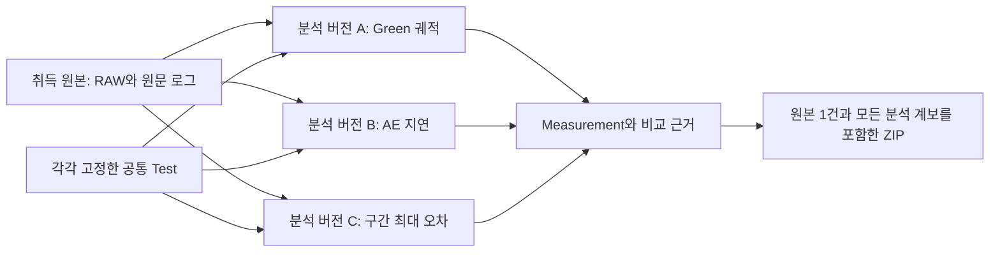

# 취득 원본과 분석 버전

이 기능은 [v0.10.0](camera-platform-response-ingest.md)으로 기본 작업실에 설치했다.
아래 개발 단계의 증거와 현재 인도 증거를 구분하며 전체 상용화 Goal은 계속 진행 중이다.

하나의 보존 RAW를 다른 응답 지표·관측 구간·판정 기준으로 재분석할 수 있다.
새 분석은 같은 취득 식별자와 데이터·픽셀 해시를 참조하므로 독립된 실측 표본이 늘지 않는다.
원문의 공통 시험/관측 연산자, 재사용 가능한 자산, 분석 플러그인 경계와 보정/검증 독립성을
연결한다. 현재 이 경로를 지원하는 분석 어댑터는 폐루프 RAW/제어 응답이다.



## 저장과 물리적 의미

- 새 `captures` 기록은 `camera_response_acquisition_v1` 형식이다. 원본 RAW와 메타데이터
  원문, 장비/Serial/출처, 실제 적용 제어·시계·누락, 취득 프로그램의 시험 Snapshot과
  RAW 형상/해시를 고정한다. 분석 결과나 지표별 불확실도는 이 기록에 저장하지 않는다.
- 새 `capture_analyses` 기록은 `camera_capture_analysis_v1` 형식이다. 취득 ID/해시,
  Test Snapshot, 관측 연산자 출력, 지표별 불확실도, 분석 환경, 이전 분석 ID/해시와
  대응 Measurement를 고정한다. Measurement의 `raw_capture_id`와 `capture_analysis_id`가
  두 기록을 연결한다. 생성된 분석은 미승인 상태다.
- 원래 업로드 메타데이터에는 첫 시험/불확실도 요청이 들어 있다. 그 파일은 원문 증거로
  그대로 보존하고, 다른 분석에 첫 지표의 불확실도를 자동 적용하지 않는다.
- 이전 형식의 취득 기록은 수정하지 않는다. 기존 첫 분석도 재생 검증할 수 있고,
  동일 원본을 참조하는 새 분석 버전을 추가할 수 있다.
- 장면·정책·프로그램·조합·물리 조건·RAW 형상과 통계 정책은 같아야 한다. 지표, Reduction,
  목표, 관측 구간, 시간 정합 허용 폭과 판정 기준은 별도 Test로 고정할 수 있다.
  변경된 제어 정책이나 카메라를 기존 취득 결과로 재해석하지 않는다.
- 새 분석은 매번 원본 픽셀과 로그에서 계산한다. 불확실도는 해당 결과의 단위/좌표 수에
  맞는 명시적 경계 또는 이유가 있는 `unknown`이어야 한다.
- 데이터 식별자·픽셀 해시는 분석마다 유지한다. 일반 Measurement 등록과 RAW 재업로드의
  중복 검사는 계속 적용하며, 재분석 전용 경로만 같은 취득을 참조한다. 같은 RAW를
  보정과 검증으로 나누어도 픽셀 콘텐츠 식별자가 같으므로 독립성이 생기지 않는다.

## API와 SDK

`POST /api/v1/capture_analyses`는 다음 입력을 받는다. 취득 출처·장비·데이터 ID를
변경하는 입력 필드는 허용하지 않는다. 응답에는 `capture`, `analysis`, `measurement`,
`test`가 함께 들어 있다. 조회는 동일한 `/capture_analyses` 컬렉션을 사용한다.

```python
from camera_platform.sdk import PlatformClient

with PlatformClient("http://127.0.0.1:8773") as client:
    draft = client.response_test_template(program_id, observable="ae_command_latency_ns")
    test = client.post("tests", draft)
    result = client.analyze_capture(
        capture_id, test["id"],
        name="AE 적용 지연", revision="2",
        uncertainty={
            "kind": "unknown", "unit": "ns",
            "reason": "이 지표의 전체 불확실도는 아직 확립되지 않음",
        },
        parent_analysis_id=None,
    )
```

원래 RAW 업로드 API도 취득·첫 분석·Measurement를 함께 생성한다.
단일 SQLite 트랜잭션으로 기록을 공개하므로 도중 실패가 부분 취득/분석/Measurement를
남기지 않는다. 같은 취득·시험·요청·환경으로 재요청하면 기존 분석/Measurement를 반환한다.
분석 요청의 새 버전이나 분석 환경이 달라지면 새 기록이 된다. 실패 전 저장된 미참조 Blob의
정리 정책은 기존 저장소 운영 과제로 남아 있다.

## 작업실

Validation의 **보존 RAW를 다른 지표로 분석** 패널에서 취득을 선택하고, 아홉 관측 지표와
세 결과 형태 중 하나로 새 공통 시험을 만들 수 있다. 축약 지표는 명시적인 목표/프레임 구간을,
정착 시간은 허용 폭/최소 표본 수를 추가로 요구한다. 현재 작성 화면의 기본 허용 오차는
무차원 0.01 또는 1 ns이고 구현 검증용 Test를 생성한다. 임의 판정 기준은 API/SDK를 사용한다.

분석할 Test·이름·버전·불확실도·선택적 이전 분석을 입력해 저장하고, 분석 이력에서 정확한
Test/Measurement를 비교에 연결할 수 있다. 해당 시험으로 새 카메라 계산도 실행한다.
원본 취득의 기존 형식 분석도 선택할 수 있다. 다른 지표를 만든 뒤 일반 AE/AWB 실행이
그 지표의 Test를 잘못 재사용하지 않도록 시험 선택 조건도 보강했다.

## 검증과 남은 범위

- [전체 회귀 시험](../reports/camera_platform/capture-analysis-tests.xml): 1,082개 통과.
  새 14개 시험은 다중 지표/단위/구간, 동시 요청, 출처·데이터 ID 변경 거부, 불확실도,
  원자적 실패, 기존 형식 호환, 실제 별도 Worker·SDK, ZIP과 백업 복원을 다룬다.
- [별도 HTTP/SDK/Worker 검사](../reports/camera_platform/capture-analysis-http-verification.json):
  기존 취득 한 건의 Green 평균·노출·AE 지연을 실제로 재분석하고 각각의 새 계산과 비교했다.
  취득 원본 유지와 요청 재시도, 분석 계보를 포함한 차단된 근거 패키지도 확인했다.
- [브라우저 검사](../reports/camera_platform/capture-analysis-ui/verification.json): 21항목 통과.
  실제 공통 Test 작성→원본 재분석→정확한 버전 선택→Worker 계산→판정 보류를 확인했다.
  모바일 가로 넘침과 JavaScript 오류가 없고 기존 형식 분석도 선택할 수 있다.

물리 검증 근거는 늘지 않았다. QA 데이터는 시뮬레이션 출처이며, 총 응답 불확실도와
독립 장비 취득/실물 예측 성능은 아직 미확립이다. 유한 구간의 표본 정착 시간을 연속 시간
안정성으로 확장하지 않으며 누락 데이터로 축약 지표를 채우지 않는다.

응답 RAW/원문 로그 전용 업로드 화면과 설치본 검증은 v0.10.0에서 인도했다.
정적 RAW ROI·일반 분석 플러그인으로의 분석 Revision 경계 확대, 분석 코드 버전 간 명시적
재생 정책, 대용량 이력 조회/저장소 운영도 남아 있다. 원문의 일반 3D·광학/픽셀/전기·HDR/LFM,
총 불확실도·최적화·사례/결정·Agent·권한·고객 환경 배포 요구를 계속 유지한다.
