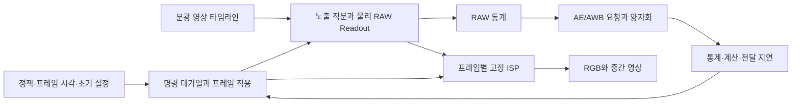

# AE/AWB 폐루프 개발 모듈

기본 작업실의 설치 버전은 **v0.9.0**입니다. `closed_loop_scene_v1` 런타임을
Registry·API·SDK·별도 Worker·화면에 연결했으며, `/#controls`에서 정책 등록부터
촬영·RAW 재처리까지 실행할 수 있습니다. 패키지 밖 개발 소스를 바꾸거나 서버를 재시작해도
고정된 RAW·제어 이력이 재현됨을 확인했습니다. 전체 플랫폼 상용화 목표는 진행 중입니다.

## 현재 연결된 계산

분광 영상의 시각별 광전자율을 준비한 뒤, 각 프레임에서 **실제 적용된 노출**에 대해
광전자를 적분하고 Dark/Noise/Full-well/Gain/ADC를 한 번 적용합니다. 그 RAW에서 통계를
얻어 다음 제어 명령을 만듭니다. 기대 전자 수나 최종 RGB를 제어의 관측값으로 사용하지 않습니다.



모듈 경계는 다음과 같습니다.

| 소스 | 역할 |
| --- | --- |
| `control_contracts.py` | 정책, 프레임 일정, 초기 설정, 통계 ROI, 제어 범위/격자, 선언 지연의 엄격한 계약 |
| `controls.py` | RAW 통계와 순수 AE/AWB 계산. 장면·기대 전자 수·미래 프레임을 받지 않음 |
| `closed_loop.py` | 준비된 광학 응답, 독립 AE/AWB 대기열, 프레임 적용, 촬영과 제어 근거 기록 |
| `control_service.py` | 불변 정책·프로그램 등록, 전체 제어 범위 검사, 시험·Worker·증거 연결 |
| `static/controls.js` | 정책 편집, 촬영 프로그램 검사·등록, 프레임별 관측과 요청·적용 이력 |
| `temporal.py` | 공통 촬영 커널. 기존 기록 조건 계산과 준비된 프레임 단위 촬영 |

`TemporalCaptureSession`은 준비가 끝나면 원래의 대형 분광 입력을 보관하지 않습니다.
필요한 작은 계약을 복사하고 공유 광학 배열을 읽기 전용으로 제공합니다. 결과의 메타데이터나
원래 요청을 수정해도 다음 촬영의 조건이 바뀌지 않습니다. 실제 RAW/RGB 결과는 각 프레임의
독립적인 배열입니다. 기록 조건 런타임의 프레임 수 제한은 여전히 16입니다.

## 정책과 물리적 의미

AE는 선언한 Native crop ROI의 Green CFA 픽셀을 사용합니다. 통계는
`(관측 ADC 코드 − 선언 Black) / (ADC White − 선언 Black)`의 평균입니다.
Dark current를 기대값으로 제거하지 않으며, WB·CCM·Tone 이전의 관측입니다.
양의 신호에서는 목표와의 EV 오차에 Deadband와 최대 EV 단계를 적용합니다.
평균이 0 이하이면 유효한 밝기 추정으로 취급하지 않고 `probe_dark`로 기록하며,
명시한 최대 단계 안에서 노출·Gain 곱을 증가시킵니다.

AE의 할당 순서는 노출 우선, 이후 Readout gain입니다. 범위로 제한하고, 최소값에서
시작하는 격자에 가장 가까운 값으로 반올림하며 정확히 절반이면 위로 갑니다.
요청한 값, 제한·양자화한 명령, 실제 적용된 값을 각각 보존합니다.
양자화한 후보가 현재 설정과 같으면 `actuator_grid_hold`로 기록하고 중복 명령을 발행하지
않습니다. 이는 목표를 달성했다는 판정이 아니며 목표 잔차와 후보 값을 그대로 남깁니다.
이 Gain은 기존 센서 행동 모델의 전하→ADC 코드 배율입니다. 실제 센서의 임의 Analog gain,
Dual conversion gain 또는 HDR 경로를 재현한다고 해석하지 않습니다.

AWB는 Native CFA 위상이 반영된 2×2 셀의 R/G/G/B를 함께 검사합니다. 한 픽셀이라도
신호 범위를 벗어나면 셀 전체를 제외해 채널마다 다른 위치를 평균하는 것을 피합니다.
유효한 셀이 부족하면 이전 WB를 유지하고 `insufficient_statistics`를 기록합니다.
전체 영상이나 처리 후 RGB로 대체하지 않습니다. 유효한 경우 Gray-world 가정에 따라
R/B Gain을 갱신하며, Green은 초기 설정의 기준 배율을 유지합니다.
따라서 초기 Green이 2라면 1로 조용히 정규화하지 않습니다.

초기 및 적용 WB는 고정 ISP 프로필의 WB 값을 **대체**합니다. 그 값에 한 번 더 곱하지
않습니다. ISP 내부의 자동 AWB는 계속 비활성이고, 외부 제어 모듈이 프레임별 고정 WB를
제공합니다. CCM·Tone 등 나머지 프로필은 변경하지 않습니다.

## 시각과 지연

시각은 공통 원점을 선언한 정수 ns입니다. 각 프레임의 적용 마감은 전체 센서의 첫 활성 행
노출 시작입니다. 통계가 준비되는 시각은 다음과 같이 계산합니다.

1. 전체 센서 마지막 행의 노출 종료
2. 선언한 Readout tail, 프레임 전달, 통계 계산 지연
3. 제어 계산 지연 → 명령 발행
4. 명령 전달, Actuator 지연 → 적용 가능

AE와 AWB는 각각 최소 프레임 지연을 가지며 항상 1 이상입니다. 적용 가능 시각과 최소
프레임 지연을 모두 만족한 명령만 적용합니다. 같은 마감에 여러 명령이 도착하면 최신
원본 프레임의 명령을 선택하고 나머지는 `superseded`로 남깁니다. 더 오래된 원본의 명령이
새 설정을 되돌리지 않으며, 시퀀스 종료 뒤에도 대기 중인 명령은 `pending_after_sequence`입니다.
명령을 만들지 않은 프레임에는 명령 발행·도착 시각을 넣지 않습니다. 통계 및 제어 계산
완료 시각과 실제로 생성된 명령의 시각을 구분합니다.

Native crop의 마지막 행이 일찍 끝나도 전체 센서의 마지막 행 시간을 사용합니다.
지연 때문에 이전 프레임의 RAW 계산 결과를 다음 촬영에 아직 사용할 수 없으면 이전 설정을
유지합니다. 마감 1 ns 차이를 반올림해서 앞 프레임에 적용하지 않습니다.

이 시각들은 `declared_simulation` 결과입니다. 기록된 하드웨어 Readout/Transport 관측값과
다른 `closed_loop_control_trace_v1`에 저장하며, 실제 장비의 시각 정확도는 `unknown`입니다.

## 범위와 산출물

- 최대 64프레임, 총 1,048,576 frame-pixels, 기존 분광 입력·Native geometry 제한 적용
- 최대 AE 노출로 모든 프레임의 장면 범위와 동일 픽셀 노출 중첩을 실행 전에 검사
- 최대 노출과 모든 선언 지연을 포함한 정수 시각 범위 검사
- RAW, RGB, 전자 수, 행별 적분 구간, ISP 중간 배열, 프레임별 조건
- 정책·프로그램 SHA-256, RAW 통계, 요청·명령·적용 이력과 지연 근거
- 예측 DN은 실현된 제어 설정에 조건부인 기대값이며, 전체 폐루프의 통계적 불확실도는 미확립

기존의 공간 불변 PSF, 영상면 타임라인, 고정 온도, 0으로 선언된 PRNU/DSNU/Column FPN
범위를 유지합니다. 일반 3D 움직임·가림, HDR/LFM, 장비 동작 또는 물리 검증은 추가되지
않았습니다. 샘플 영상에서 AE가 수렴하거나 AWB가 채널 평균을 맞췄다는 사실은 실물 카메라나
임의 장면의 제어 품질을 보증하지 않습니다.

## 개발 소스에서 재현

프로젝트의 개발 환경에서 다음을 실행합니다. 현재 설치된 작업실에 명령을 보내지 않습니다.

```sh
.venv-platform/bin/python tools/verify_camera_closed_loop.py
.venv-platform/bin/python -m pytest -q tests/platform/test_closed_loop.py
```

직접 사용하는 Python 진입점은 다음과 같습니다.

```python
from camera_platform.closed_loop import request_template
from camera_platform.runtime import run_plugin

request = request_template()  # 명시적으로 합성된 영상면/제어 예제
output = run_plugin("closed_loop_scene_v1", request)
raw = output["arrays"]["raw_frames"]
trace = output["summary"]["control_trace"]
```

검증 스크립트는 48프레임의 광량·스펙트럼 변화, 고정 조건 비교, AWB 단독 비교를 실제로
계산하고 요청 JSON, 전체 Summary, NumPy 배열, 그래프, 소스 환경 해시를
`reports/camera_platform/closed-loop-development/`에 저장합니다. 이 보고서는 설치본의
`delivery.json`과 별도입니다.

## 작업실에서 사용하는 순서

1. **AE · AWB 제어**에서 카메라 구성과 기존 시간 장면을 선택합니다.
2. 새 정책 초안을 불러와 AE·AWB, 노출·Gain 범위, 격자, 지연을 편집합니다.
   이름·버전·출처·통계 ROI·추가 제어 값은 정책 JSON에서 지정합니다.
3. 정책을 등록한 뒤 프레임 수를 정하고 촬영 프로그램 초안을 만듭니다.
   초안은 Global shutter이며, 프로그램 JSON에서 Rolling shutter와 행 시간,
   숨겨진 상단 행, 초기 WB 및 프레임 일정을 지정할 수 있습니다.
4. **전체 제어 범위 검사**는 Lens·Sensor·ISP의 유효 영역이 정책의 전체 노출·Gain 구간을
   포함하는지 검사합니다. 명시된 축 정렬 구간의 포함 관계와 고정 적용 조건을 검사하므로
   초기 설정이나 일부 샘플만 통과하는 것으로 대체하지 않습니다. 실패한 검사는 등록 기록이나
   계산 작업을 만들지 않습니다. 초안을 편집하면 이전 검사 결과는 즉시 무효화됩니다.
5. 검사한 프로그램을 등록하고 실행합니다. 시험은 프로그램·정책·장면·모델·계획 시각을
   고정하며, 아직 결정되지 않은 프레임 적용 설정은 실행 후에만 기록합니다.
6. 마지막 관측값과 목표 잔차, 프레임별 RAW 통계·WB·명령·실제 반영을 확인합니다.
   실제 RAW/RGB 배열, 제어 이력 JSON, 원본 포함 ZIP을 내보낼 수 있습니다.
7. RAW 재처리로 이동하면 원본 취득 이력과 RAW를 보존하면서 다른 고정 ISP를 적용합니다.
   AE를 다시 실행하거나 다른 노출의 광자 통계를 재생성하지 않습니다.

등록된 정책과 프로그램은 불변입니다. 편집 중인 정책은 새로 등록하고 새 프로그램에서 선택해야
반영됩니다. 정책에서 Gain 8을 허용하더라도 모델 유효 영역이 Gain 1이면 검사가 실패합니다.
근거 없이 모델 영역을 넓히지 않으며, 필요한 경우 정책 범위를 실제 모델에 맞추어 제한하거나
적절한 근거를 가진 새 모델을 등록합니다.

API의 `/control_policies/import`, `/control_programs/import`는 `document_text`의 원본 UTF-8
바이트와 정규화 문서를 함께 보존합니다. 브라우저 편집과 검사에서는 JavaScript가 정확히 표현할
수 있는 정수만 허용합니다. 큰 절대 시각은 선언한 원점에 상대적인 ns로 표현하거나 Python SDK를
사용해야 합니다. 모델 출처·환경·입력 아티팩트와 실제 촬영 이력은 실행에 고정됩니다.

### Python SDK

```python
from camera_platform.sdk import PlatformClient

with PlatformClient("http://127.0.0.1:8770") as client:
    policy = client.create_control_policy(policy_document)
    program_document["control_policy_id"] = policy["id"]
    check = client.check_control_program(program_document)
    program = client.create_control_program(program_document)
    test_document = client.get(
        "templates/closed-loop-test?control_program_id=" + program["id"]
    )
    test = client.post("tests", test_document)
    run = client.submit_closed_loop(
        program["assembly_id"], test["id"], program["id"], seed=42
    )
    result = client.wait(run["id"])
```

### 통합 검증

`tests/platform/test_control_workflow.py`는 실제 32프레임 촬영, 전체 영역 이탈 거부,
원본 바이트·불변 입력·시드 보존, API/SDK/별도 Worker, 제어 RAW 재처리, ZIP 및 백업/복원을
검사합니다. `tools/prepare_camera_control_qa.py`는 기존 상태를 덮어쓰지 않고 명시적으로
합성된 시험용 모델·PSF·장면을 생성합니다. `tools/verify_camera_controls_ui.cjs`는 실제
브라우저에서 등록·실행·재처리하고, 늦게 도착한 검사 응답과 편집, 재실행 캐시, 새로고침 및
데스크톱·모바일 화면을 검사합니다. 이 입력들은 독립 실측을 대신하지 않습니다.

## 남은 검증과 배포 작업

현재 폐루프 RAW는 생성된 적용 조건에 종속된 관측입니다. 기존 고정/기록 조건 비교 연산자로
초기 설정을 모든 프레임의 취득 조건처럼 취급하면 잘못된 판정이 됩니다. 따라서 폐루프 시험이나
예측을 이 비교기에 넣으면 **INCONCLUSIVE**를 반환하며, 값이 우연히 같아도 실물 검증 PASS로
표시하지 않습니다. 기록 조건으로 정합한 비교 또는 독립적으로 정의된 제어 궤적 관측 연산자와
실측 데이터의 연결은 아직 필요합니다.

v0.9.0 설치 패키지와 기본 작업실 갱신은 검증했습니다. 기존 의존성을 공유하는 로컬 실행이며,
깨끗한 고객 OS의 의존성 해결·완전 격리·이전·부하 검증은 아직 남아 있습니다.
일곱 모듈, 네 실행 방식, 일반 물리 모델·3D, HDR/LFM, 전체 불확실도, 고급 최적화,
Agent·의사결정·권한·배포를 포함한 원래 Goal은 계속 진행 중입니다.
