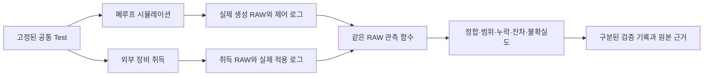

# 폐루프 응답의 공통 RAW 관측과 비교

이 기능은 [v0.10.0](camera-platform-response-ingest.md)으로 기본 작업실에 설치했다.
원문의 §7.3 제어, §8.1 공통 시험, §8.2 검증 구분, §8.3 관측 과정에 해당한다.
아래 개발 단계별 근거와 현재 설치 인도 근거를 구분하며, 전체 상용화 목표는 계속 진행 중이다.

기존 폐루프 Run은 RAW 채널 평균 비교를 일괄 보류했습니다. 이제 관측 방법을 명시한
공통 Test에서는 실제 ADC RAW와 적용된 설정·명령 로그를 같은 함수로 분석하고,
짝지을 수 있는 관측의 잔차를 계산합니다. 전체 불확실도가 없는 경우 수치가 일치해도
판정은 `INCONCLUSIVE`입니다. 관측 방법이 없는 기존 시험의 보류 동작은 유지합니다.

## 모듈과 데이터 흐름

| 경계 | 구현 |
| --- | --- |
| 관측 계약·순수 계산 | `control_observation.py`: Native CFA/ROI, 시계 대응, 실제 설정·명령, 누락·구간 분석 |
| 공통 비교 | `control_comparison.py`: 동일 Test 관측, 짝지은 좌표, 각 프레임의 적용 범위와 불확실도 |
| 제품 연결 | `control_response_service.py`: Test 생성, 실제 Worker 관측, RAW 가져오기·재분석 확인·원본 보존 |
| 외부 진입점 | 기존 Tests/Runs/Measurements/Validations API, 추가 응답 Test 템플릿·취득 업로드, Python SDK |
| 화면 | `control-response.js`: 보존된 관측·단위·누락·잔차 표. 기록 선택 후 같은 Test 재실행 |



외부 장비 취득은 현재 파일 업로드 경계입니다. 실제 장비 제어 드라이버·장비 연결을
구현하거나 검증했다는 의미가 아닙니다.

## 관측값과 구간 분석

| 관측값 | 단위·의미 |
| --- | --- |
| `green_mean_normalized` | 1. 실제 Green ADC 코드의 `(code-black)/(white-black)` 평균. 음수도 보존 |
| `wb_adjusted_rg_ratio`, `wb_adjusted_bg_ratio` | 1. 같은 유효 2×2 Bayer 셀의 채널 평균과 실제 WB로 계산한 비율 |
| `exposure_ns`, `gain` | 실제 적용 노출(ns)과 Gain(1) |
| `wb_red_gain`, `wb_blue_gain` | 실제 적용 WB Gain(1) |
| `ae_command_latency_ns`, `awb_command_latency_ns` | 같은 로그 시계의 명령 발행→적용 시간(ns). 명령의 **원본 프레임**이 비교 좌표 |

분석 방식은 `trajectory`, `peak_absolute_target_error`, `sampled_settling_time`입니다.
후자의 두 방식은 목표와 시작·끝 프레임을 시험에 고정합니다. 정착 시간은 추가로 허용 띠와
최소 유지 표본 수(2 이상)를 요구하며, 해당 표본부터 구간 끝까지 모두 띠 안에 있어야 합니다.
연속 시간 안정성, 구간 밖 유지, 미관측 전이 시각은 주장하지 않습니다.

WB 비율은 Gray-world 진단값이며 DeltaE나 일반 색 정확도가 아닙니다. 예상 전하량·예상 RGB를
관측 입력으로 사용하지 않습니다. Dark current 제거·Resizing·Demosaic·포화 셀의 대체값도
추가하지 않습니다. ADC 범위 검사만으로 실물 선형성이나 숨은 Full-well clipping을 확인할 수
없습니다.

## 공통 Test와 취득 기록

기존 `TestCreate`의 `observation_method`, `observation_specification`,
`observation_shape`에 분석 계약을 고정합니다. 지표 ID는
`control.response.<observable>.<reduction>`이며 결과 단위도 특성 사전에 등록합니다.
프로그램·정책·장면 해시, Native 형상, RAW 형식, 통계 정책, Shutter 모드, 계획 프레임,
고정 광학·환경 조건은 등록된 프로그램과 일치해야 합니다.

취득 메타데이터는 `ResponseCaptureImport` 계약입니다. 주요 항목:

- 출처·방법 버전·라이선스·Dataset ID, Test/Assembly ID와 고정 조건
- 원래 취득 시계, `test_time = logged_time + test_clock_offset_ns`인 단일 대응,
  전체 구간의 대응 오차 경계와 그 출처·방법
- 모든 계획 프레임의 순서 있는 기록. `raw_index=null`은 RAW 누락이며 나머지 인덱스는
  중복 없이 0부터 이어져야 함
- 실제 Frame start/Latch 시각과 Exposure/Gain/WB/ISP. 모르는 값은 명시적 null
- AE/AWB 명령 ID, 원본·적용 프레임, 실제 발행·적용 시각, 요청·명령 값과 상태
- 선택한 **최종 관측 지표**의 불확실도. `unknown`에는 이유를, `absolute_bound`에는
  단위·값 또는 좌표별 값·유도 방법·출처를 제공

시계의 임의 재정렬·속도 변경·Time warping이나 프레임 보간은 하지 않습니다. 명령이 없었던
프레임에는 지연값을 만들지 않고, 명령이 있지만 적용 여부·시각이 없으면 미확인으로 남깁니다.
허용 시각 정렬 구간에 경계 전체가 포함되지 않으면 비교를 보류하거나 거부합니다.

실측 출처에는 Serial, 장비 ID·교정 버전, 해당 정책의 장비 구현 근거가 추가로 필요합니다.
이 선언과 해시는 출처 진위의 인증을 대신하지 않습니다. 등록된 시뮬레이션 RAW를 재인코딩해
실측으로 이름만 바꾼 경우에는 정규화 픽셀 해시로 거부합니다.

현재 입력 한계는 선형 RGGB, 2–16 bit, 단일 Unpacked Bayer 스트림, Native crop의 정수
NPY `[N,H,W]`, 최대 64개 계획 프레임·512×512 crop, 업로드 RAW 파일 64 MiB입니다.
적어도 하나의 RAW 프레임이 필요합니다. 일반 Vendor Decoder/HDR·로그만 있는 취득은 후속 범위입니다.

## SDK 사용 흐름

개발 서버에 등록된 `program_id`, `assembly_id`를 사용합니다.

```python
from camera_platform.sdk import PlatformClient

with PlatformClient("http://127.0.0.1:8773") as client:
    draft = client.response_test_template(
        program_id, observable="wb_adjusted_rg_ratio"
    )
    # 허용 오차와 검증 종류는 실제 시험 계획에 맞게 고정한다.
    test = client.post("tests", draft)
    queued = client.submit(
        assembly_id, test["id"], plugin_id="closed_loop_scene_v1",
        control_program_id=program_id, parameters={"seed": 123},
    )
    run = client.wait(queued["id"])
    imported = client.import_control_response(metadata, "/absolute/path/raw.npy")
    report = client.compare(run["id"], imported["measurement"]["id"], test["id"])
```

새 API는 `POST /api/v1/control_response_tests/template`와
`POST /api/v1/captures/control-response/import`입니다. 후자는 Multipart의 `metadata` JSON
문자열과 `raw` 파일을 받습니다. 기존 토큰·동일 Origin·본문 크기 제한을 적용합니다.
취득 JSON의 원래 UTF-8 바이트와 RAW NPY, 분석 JSON, 분석 당시 코드/환경을 보존합니다.
검증 시 원본 RAW를 다시 분석해 측정 계약과 일치하는지 확인합니다.

## 검증 증거와 남은 작업

- [회귀 시험](../reports/camera_platform/control-response-tests.xml): 기존 범위와 새 관측·연결 시험 포함
  1,068개 통과. 새 시험 36개에는 독립 RAW 산술, 홀수 Native crop, 누락·시계·범위·불확실도,
  실제 별도 Worker/SDK·업로드·RAW 재처리가 포함됩니다.
- [실제 개발 HTTP/Worker](../reports/camera_platform/control-response-http-verification.json): 합성
  32프레임 중 RAW 하나를 누락한 관측을 등록하고 28쌍의 잔차와 4개의 미확인 표본을 보존했습니다.
  기존 3프레임은 WB 공통 유효 셀이 부족했습니다. 원본 포함 근거 ZIP도 확인했습니다.
- [브라우저 검증](../reports/camera_platform/control-response-ui/verification.json): 최종 통과 여부와
  읽기 전용 검사·명시적 QA 재실행 범위는 이 파일을 따릅니다.

**후속 개발분:** [취득 원본과 분석 버전](camera-platform-capture-analysis.md)을 분리했다.
같은 Dataset·픽셀 계보를 유지하면서 여러 지표를 재분석하며, 기존 형식의 원본도 보존한다.
Test 작성·분석 버전 선택 화면과 API/SDK, 원자적 저장·계보 ZIP·백업 복원을 연결했다.
후속 회귀 시험은 1,082개, 실제 HTTP/Worker 5항목과 브라우저 21항목이 통과했다.
응답 RAW/원문 로그 전용 업로드 화면과 설치 패키지는 v0.10.0에서 인도했다.

실측 취득·독립 검증, 총 모델/수치/표본/타이밍 불확실도 전파, 장비 정책 동등성 검증,
고객 환경의 독립 설치·운영 검증은 별도로 남아 있습니다. 이 기능의 시험 통과는 일반 3D·렌즈/픽셀/전기 모델,
HDR/LFM·고급 최적화·Agent·팀 권한·고객 배포까지 완료했다는 의미가 아닙니다.
